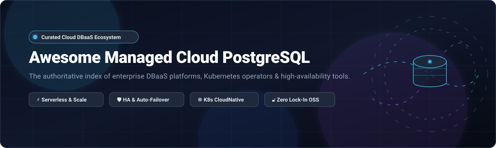
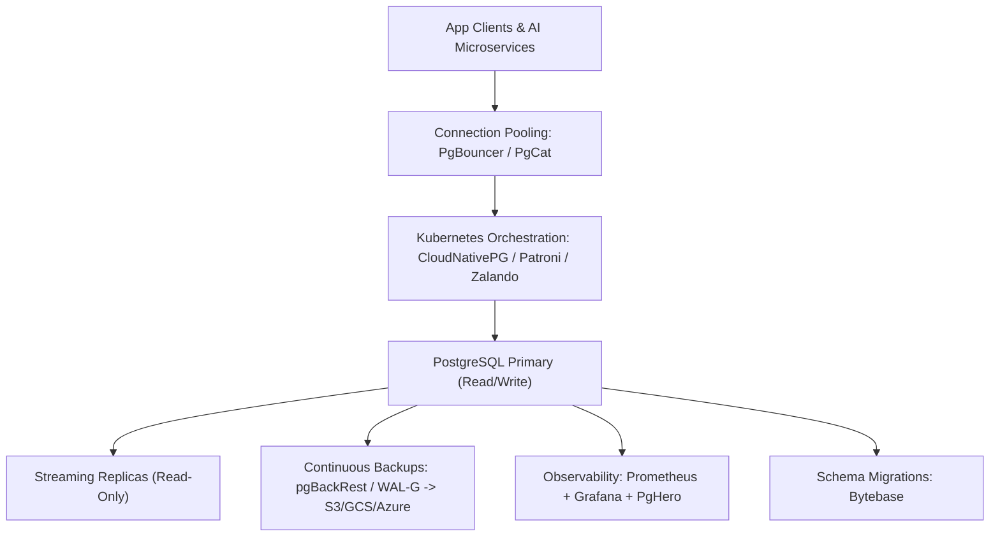

# 🐘 Awesome Managed Cloud PostgreSQL Database 🚀

**A definitive, SEO-optimized curated directory of Managed Cloud PostgreSQL Databases (DBaaS), Serverless Postgres Platforms, Kubernetes Operators, High-Availability (HA) Engines, and Open-Source Ecosystem Tools.**

*Designed for Platform Engineers, Database Administrators (DBAs), DevOps Architects, and Cloud Developers building resilient, production-ready PostgreSQL infrastructure without vendor lock-in.*

📅 *Last updated: October 2026*

---

## 📑 Table of Contents
- [🔍 Sector Overview & Market Dynamics](#-sector-overview--market-dynamics)
- [☁️ SaaS / Hosted DBaaS Platforms](#️-saas--hosted-dbaas-platforms)
- [🔓 Open-Source GitHub Projects](#-open-source-github-projects)
- [🏗️ Architectural Stacks & Custom DBaaS Blueprints](#️-architectural-stacks--custom-dbaas-blueprints)
- [🤝 How to Contribute](#-how-to-contribute)
- [💖 Support & Sponsorship](#-support--sponsorship)
- [📈 Star History](#-star-history)
- [⚖️ Disclaimer](#️-disclaimer)

---

## 🔍 Sector Overview & Market Dynamics

The global **Database-as-a-Service (DBaaS)** and managed cloud database ecosystem represents an estimated **$25B–$35B** market size, expanding at a robust **15%–18% CAGR** and projected to exceed **$100B+** by the early 2030s.

The market exhibits a clear dual-structure:
* **Infrastructure Layer (High Concentration / Hyperscaler Oligopoly):** Dominated by the big-three cloud giants—**Amazon Web Services (AWS RDS/Aurora)**, **Microsoft Azure (Flexible Server)**, and **Google Cloud (Cloud SQL/AlloyDB)**—who control the majority of enterprise revenue through deep cloud ecosystem bundling, global compliance certifications, and integrated networking.
* **Developer & AI-Native Layer (Moderate Fragmentation & Active M&A):** Rapidly expanding challenger platforms—such as **Supabase**, **Neon**, **CockroachDB**, and **Timescale**—differentiate through developer ergonomics, instant copy-on-write branching, sub-second cold-start scale-to-zero, vector search (pgvector), and AI-agent automation. This layer experiences frequent strategic consolidation into broader data ecosystems (e.g., Databricks acquiring Neon).

---

## ☁️ SaaS / Hosted DBaaS Platforms

The table below lists the category-leading hosted PostgreSQL services, ranked by **Company Scale** (Valuation / Revenue in descending order) with exact entry-level pricing tiers and free tier / trial terms.

| 🏢 Platform | 📊 Company Scale (Valuation / Revenue) | 💵 Starting Tier Pricing | 🎁 Free Tier / Trial Limits | 🌟 Architectural Highlights |
| :--- | :--- | :--- | :--- | :--- |
| **[Microsoft Azure (Azure Database for PostgreSQL)](https://azure.microsoft.com/en-us/products/postgresql/)** | ~$3.1T Market Cap / ~$245B+ Annual Revenue | ~$12 - $15/month (Flexible Server Burstable `Standard_B1ms` / `B1s`) | 12-month free trial: 750 hrs/month of `Standard_B1ms` (1 vCore) compute + 32 GB storage | Enterprise-grade managed PostgreSQL with built-in HA, zone redundancy, elastic scaling, and deep Azure ecosystem integration. |
| **[Google Cloud (Cloud SQL for PostgreSQL)](https://cloud.google.com/sql/docs/postgres)** | ~$2.1T Market Cap / ~$350B+ Annual Revenue | $11.32/month (Shared-core `db-f1-micro` 1 vCPU, 0.6 GB RAM + storage) | 90-day free trial with $300 universal credits; or dedicated 30-day Cloud SQL trial instance (up to 8 vCPUs, 64 GB RAM, 100 GB storage) | Fully managed PostgreSQL with automated point-in-time recovery (PITR), replication, IAM authentication, and Vertex AI integration. |
| **[AWS (Amazon RDS for PostgreSQL)](https://aws.amazon.com/rds/postgresql/)** | ~$2.0T Market Cap / ~$105B+ AWS Annual Run-Rate | ~$11.68/month (`db.t4g.micro` single-AZ on-demand, ~$0.016/hr) | 12-month free trial: 750 hrs/month of `db.t2.micro`/`t3.micro`/`t4g.micro` compute + 20 GB gp2/gp3 storage + 20 GB backup storage | Industry standard for managed PostgreSQL with Multi-AZ HA failover, automated snapshots, read replicas, and Performance Insights. |
| **[Salesforce (Heroku Postgres)](https://www.heroku.com/postgres)** | ~$280B Market Cap / ~$38B Annual Revenue | $5/month (`Essential-0` plan) | No free tier or trial (permanent free plans discontinued in 2022; pay-as-you-go billed per-second, starting at $5/mo with 1 GB storage & 20 connections) | Tightly integrated with Heroku PaaS, offering seamless Dataclips, follower databases, fork testing, and CLI integrations. |
| **[Supabase](https://supabase.com/)** | $10.5B Valuation / ~$170M ARR | $25/month (Pro tier) | Free forever plan: 2 free projects, 500 MB database storage, 1 GB file storage, 50,000 monthly active users, 2 GB egress (pauses after 1 week inactivity) | Open-source Firebase alternative featuring managed PostgreSQL, Realtime engine, Row Level Security (RLS), Auth, and auto-generated APIs. |
| **[CockroachDB Cloud](https://www.cockroachlabs.com/)** | $5B Valuation / ~$130M - $160M ARR | $0.18/hour (~$130/month for 2 vCPU Standard provisioned) | Free forever plan (Basic tier): 50M Request Units (RUs)/month + 10 GiB storage ($15/mo recurring credit); + 30-day trial with $400 credits for new orgs | Distributed SQL database offering PostgreSQL wire compatibility, multi-region survivability, horizontal sharding, and serverless scale-to-zero. |
| **[Aiven for PostgreSQL](https://aiven.io/postgresql)** | ~$3B Valuation / ~$109M ARR | $5/month (Developer tier) | Free forever plan: 1 dedicated VM, 1 CPU, 1 GB RAM, 1 GB storage (powers down on prolonged inactivity, easily restarted) | Managed PostgreSQL with multi-cloud deployment (AWS, GCP, Azure), automated backups, pgvector, and integrated observability. |
| **[Neon](https://neon.tech/)** | ~$1B Valuation (Acquired by Databricks) / ~$25M ARR | Pay-as-you-go from $0 (Launch plan: $0.106/CU-hour + $0.35/GB-month storage, typically ~$15/mo for small apps) | Free forever plan: Up to 100 projects, 100 CU-hours/month, 1 GB storage per project (20 GB shared cap), 5 GB egress, auto-suspends after 5 min idle | Serverless PostgreSQL with separated storage and compute, instant copy-on-write database branching, and sub-second cold starts. |
| **[Timescale Cloud](https://www.timescale.com/)** | >$1B Valuation / ~$180M total funding | $30/month (Performance tier starting compute + storage) | Free forever plan: 2 database services, 750 MiB storage per service (shifts to read-only when full); + 30-day free trial of Performance tier without credit card | Purpose-built time-series and event PostgreSQL platform featuring hypertables, continuous aggregates, vector search, and columnar compression. |
| **[Tembo](https://tembo.io/)** | ~$80M Valuation / ~$21M total funding | $15/month (Starter tier) | Free forever plan (Hobby tier): 0.25 vCPU, 1 GB RAM, 10 GB storage, unlimited reads/writes, support for 200+ Postgres extensions | Managed PostgreSQL platform with pre-configured workload stacks (vector, time-series, message queue, analytics) deployable on any cloud. |

---

## 🔓 Open-Source GitHub Projects

Curated open-source projects for self-hosting, orchestrating, monitoring, and scaling PostgreSQL clusters. All repositories are sorted by **GitHub Stargazer Count (Descending)** with official social Stars_Badges linked directly to each repository's stargazers page.

1. **[Supabase](https://github.com/supabase/supabase)**  — The open-source Firebase alternative. Complete self-hosted backend platform providing a dedicated PostgreSQL database, authentication, instant APIs, edge functions, and real-time subscriptions. *Apache-2.0 licensed.*
2. **[Grafana](https://github.com/grafana/grafana)**  — The open and composable observability and data visualization platform. Industry gold standard for building PostgreSQL performance monitoring and query telemetry dashboards. *AGPL-3.0 licensed.*
3. **[DBeaver](https://github.com/dbeaver/dbeaver)**  — Free multi-platform universal database tool for developers, database administrators, and analysts supporting PostgreSQL, spatial extensions, and cloud DBs. *Apache-2.0 licensed.*
4. **[Metabase](https://github.com/metabase/metabase)**  — The easiest, open-source business intelligence and analytics platform for querying, visualizing, and sharing business metrics from PostgreSQL databases. *AGPL-3.0 licensed.*
5. **[CockroachDB](https://github.com/cockroachdb/cockroach)**  — Cloud-native distributed SQL database with PostgreSQL wire compatibility, designed for global ACID transactions, horizontal scaling, and zero-downtime survivability. *BSL / Enterprise.*
6. **[PostgREST](https://github.com/PostgREST/postgrest)**  — Standalone web server that turns any PostgreSQL database directly into a secure, high-performance RESTful API, enforcing database-level permissions. *MIT licensed.*
7. **[TimescaleDB](https://github.com/timescale/timescaledb)**  — Open-source time-series SQL database built as an extension on PostgreSQL, providing automated data partitioning (hypertables) and 90%+ compression. *Apache-2.0 / TSL licensed.*
8. **[pgvector](https://github.com/pgvector/pgvector)**  — Open-source vector similarity search extension for PostgreSQL, powering AI agent memory, RAG pipelines, and embeddings (HNSW, IVFFlat). *PostgreSQL licensed.*
9. **[Neon (Self-Hosted)](https://github.com/neondatabase/neon)**  — Open-source serverless PostgreSQL with separated storage and compute written in Rust. Features copy-on-write branching, cold start scale-to-zero, and local testing. *Apache-2.0 licensed.*
10. **[Bytebase](https://github.com/bytebase/bytebase)**  — Database CI/CD and DevOps management tool for PostgreSQL and other DBs, offering GitOps schema change automation, SQL review, and data masking. *Apache-2.0 licensed.*
11. **[Citus](https://github.com/citusdata/citus)**  — Open-source PostgreSQL extension that transforms Postgres into a distributed database, sharding tables and parallelizing queries across multiple nodes. *Apache-2.0 licensed.*
12. **[FerretDB](https://github.com/FerretDB/FerretDB)**  — Open-source proxy that translates MongoDB wire protocol queries into PostgreSQL SQL, providing an open-source alternative to MongoDB on top of Postgres. *Apache-2.0 licensed.*
13. **[YugabyteDB](https://github.com/yugabyte/yugabyte-db)**  — Open-source distributed SQL database with PostgreSQL wire compatibility, built for cloud-native transactional applications requiring multi-region resilience. *Apache-2.0 licensed.*
14. **[ElectricSQL](https://github.com/electric-sql/electric)**  — Local-first sync layer for PostgreSQL, enabling real-time bi-directional data replication between cloud Postgres instances and client applications. *Apache-2.0 licensed.*
15. **[CloudNativePG](https://github.com/cloudnative-pg/cloudnative-pg)**  — Kubernetes Operator that covers the full lifecycle of a High Availability PostgreSQL cluster on Kubernetes, with native replication, fencing, and automated failover. *Apache-2.0 licensed.*
16. **[ParadeDB](https://github.com/paradedb/paradedb)**  — Modern search and analytics engine built on PostgreSQL, integrating BM25 full-text search and columnar storage as an Elasticsearch alternative. *AGPL-3.0 licensed.*
17. **[PgHero](https://github.com/ankane/pghero)**  — Lightweight, automated performance dashboard for PostgreSQL, highlighting slow queries, missing indexes, cache hit rates, and dead tuples. *MIT licensed.*
18. **[Patroni](https://github.com/patroni/patroni)**  — Battle-tested High Availability template and orchestrator for PostgreSQL using Distributed Consensus Stores (etcd, Consul, ZooKeeper, or Kubernetes API). *MIT licensed.*
19. **[Pigsty](https://github.com/Vonng/pigsty)**  — Battery-included PostgreSQL distribution and local/cloud DBaaS solution featuring built-in monitoring, high availability, and extension management. *AGPL-3.0 licensed.*
20. **[Zalando Postgres Operator](https://github.com/zalando/postgres-operator)**  — Production-proven Kubernetes operator for PostgreSQL with Patroni-based HA, streaming replication, automated failover, and Spilo containers. *MIT licensed.*
21. **[Stolon](https://github.com/sorintlab/stolon)**  — Cloud-native PostgreSQL High Availability manager resilient to network partitions, supporting Kubernetes integration and point-in-time recovery. *Apache-2.0 licensed.*
22. **[Crunchy Data Postgres Operator](https://github.com/CrunchyData/postgres-operator)**  — Enterprise Kubernetes Operator (PGO) automating automated failover, pgBackRest backups, connection pooling, and multi-cluster deployments. *Apache-2.0 licensed.*
23. **[pgBackRest](https://github.com/pgbackrest/pgbackrest)**  — High-throughput backup and restore system for PostgreSQL with multi-threaded compression, delta restore, async archiving, and cloud object store integration. *MIT licensed.*
24. **[PgBouncer](https://github.com/pgbouncer/pgbouncer)**  — Lightweight, lightning-fast connection pooler for PostgreSQL that minimizes server memory overhead and manages thousands of client connections. *ISC licensed.*
25. **[WAL-G](https://github.com/wal-g/wal-g)**  — Archival and restoration tool for PostgreSQL continuous backup and point-in-time recovery with S3, Google Cloud Storage, and Azure Blob support. *Apache-2.0 licensed.*
26. **[PgCat](https://github.com/postgresml/pgcat)**  — Next-generation PostgreSQL connection pooler and proxy written in Rust with built-in sharding, query routing, load balancing, and failover. *MIT licensed.*
27. **[pgAdmin 4](https://github.com/pgadmin-org/pgadmin4)**  — Feature-rich, web-based and desktop administration platform for PostgreSQL with query analysis, schema visualization, and server monitoring. *PostgreSQL licensed.*
28. **[Barman](https://github.com/EnterpriseDB/barman)**  — Backup and Recovery Manager for PostgreSQL disaster recovery, zero-data-loss remote backups, and point-in-time recovery. *GPL-3.0 licensed.*
29. **[pg_partman](https://github.com/pgpartman/pg_partman)**  — PostgreSQL extension for managing partition sets by time or serial ID, automating partition creation, detachment, and maintenance. *PostgreSQL licensed.*
30. **[Spilo](https://github.com/zalando/spilo)**  — High Availability PostgreSQL and Patroni appliance bundled with WAL-E/WAL-G in a single Docker container, engineered by Zalando. *MIT licensed.*
31. **[Repmgr](https://github.com/EnterpriseDB/repmgr)**  — Open-source replication and failover management tool suite for PostgreSQL clusters, featuring automated standby promotion and monitoring. *GPL-3.0 licensed.*
32. **[Tembo (Self-Hosted)](https://github.com/tembo-io/tembo)**  — The open-source, developer-first Kubernetes operator for Tembo platform clusters, enabling custom workload stacks and automated extensions. *Apache-2.0 licensed.*
33. **[Percona Operator for PostgreSQL](https://github.com/percona/percona-postgresql-operator)**  — Kubernetes Operator for automating the deployment and management of enterprise Percona Distribution for PostgreSQL clusters. *Apache-2.0 licensed.*
34. **[Autobase](https://github.com/timescale/autobase)**  — Open-source automation framework for self-hosted DBaaS, orchestrating failover, automated snapshots, and scaling across cloud VMs. *Apache-2.0 licensed.*

---

## 🏗️ Architectural Stacks & Custom DBaaS Blueprints

To build a complete, production-grade self-hosted managed PostgreSQL platform without cloud vendor lock-in, combine these open-source building blocks:

* **HA & Orchestration**: [CloudNativePG](https://github.com/cloudnative-pg/cloudnative-pg) or [Patroni](https://github.com/patroni/patroni) on Kubernetes.
* **Backup & Disaster Recovery**: [pgBackRest](https://github.com/pgbackrest/pgbackrest) or [WAL-G](https://github.com/wal-g/wal-g) pushing to S3/GCS object stores.
* **High-Throughput Connection Pooling**: [PgBouncer](https://github.com/pgbouncer/pgbouncer) or [PgCat](https://github.com/postgresml/pgcat).
* **Monitoring & Diagnostics**: [Grafana](https://github.com/grafana/grafana) + [PgHero](https://github.com/ankane/pghero).
* **AI & Search Extensions**: [pgvector](https://github.com/pgvector/pgvector) + [ParadeDB](https://github.com/paradedb/paradedb).

---

## 🤝 How to Contribute

Contributions are welcome and appreciated!
1. 🍴 Fork this repository.
2. 🌿 Create a descriptive feature branch (`git checkout -b add-new-postgres-tool`).
3. 📝 Add your entry under the appropriate section in alphabetical or ranked order with factual details and official links.
4. 🚀 Open a Pull Request with a short summary of the addition.

---

## 💖 Support & Sponsorship

If you found this curated list helpful for your database infrastructure, architecture reviews, or open-source stack design:

* ⭐ **Star this repository** to help others discover it on GitHub!
* 🍴 **Fork and share** with colleagues and platform engineering teams.
* ☕ **Buy me a coffee & support my open-source work**:  
  👉 **[Sponsor on GitHub Sponsor Dashboard](https://github.com/sponsors/ishandutta2007)**

Thank you to all community contributors, database developers, and open-source maintainers! 🙌

---

## 📈 Star History

---

## ⚖️ Disclaimer

* This repository is an independent, community-curated educational directory and is not officially affiliated with or endorsed by the PostgreSQL Global Development Group, AWS, Microsoft, Google, or any listed vendor.
* Managed database deployments handling sensitive data must adhere to relevant compliance mandates (SOC 2, ISO 27001, HIPAA, GDPR). Always test self-hosted disaster recovery procedures in staging prior to production deployment.
